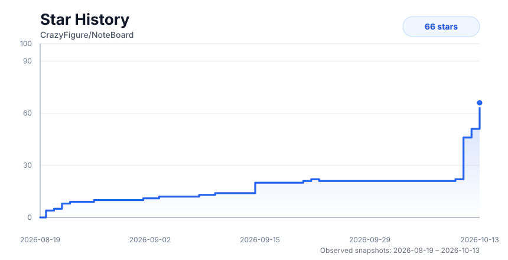

<div align="center">
  

  # NoteBoard

  **Windows / macOS / Linux / 安卓 / 网页 笔记 + 画板 + 多维表格 + 知识工作台**

  [](LICENSE)
  
  
  [](https://github.com/CrazyFigure/NoteBoard/releases/latest)
</div>

<p align="center">
  <a href="assets/tour.mp4"></a>
  <br />
  ▶ <a href="assets/tour.mp4">观看高清完整版</a>
</p>

---

本地优先、文件优先：无强制工作区、无强制云同步，双击即开、即开即写，数据完全由你掌控。

## 下载安装

| 平台 | 安装包（[最新 Release](https://github.com/CrazyFigure/NoteBoard/releases/latest)） | 说明 |
|---|---|---|
| **Windows** | `NoteBoard_x.y.z_windows_x64-setup.exe` | Win10 1809+，需 WebView2（Win11 已内置） |
| **安卓** | `NoteBoard_x.y.z_android_arm64.apk` | arm64 设备 |
| **macOS** | `.dmg` | Apple Silicon / Intel 分别提供；未经 Apple 公证 |
| **Linux** | `.deb` / `.AppImage` | x86_64；AppImage 需 `chmod +x`，可能需安装 FUSE |
| **网页** | Docker 镜像 `crazyfigure/noteboard` | 见下方 [网页部署](#网页部署) |

| 软件包管理器 | 安装 | 更新 |
|---|---|---|
| WinGet | `winget install --id CrazyFigure.NoteBoard --exact` | `winget upgrade --id CrazyFigure.NoteBoard --exact` |
| Homebrew | `brew install --cask crazyfigure/tap/noteboard` | `brew update && brew upgrade --cask crazyfigure/tap/noteboard` |

## 插件与字体

文档查看器、电子书阅读与多维表格工作台以**官方插件**形式独立发布，推荐字体以**字体包**形式提供，均在应用内安装：

> **设置 → 插件** → 下载 / 勾选启用；同一页面可检查插件更新，底部「字体」区域一键下载字体。

| 资源 | 内容 | 链接 |
|---|---|---|
| 官方插件 | Word、Excel、PowerPoint、PDF、CAD 查看，EPUB 阅读，多维表格工作台 | [plugins Release](https://github.com/CrazyFigure/NoteBoard/releases/tag/plugins) |
| 字体包 | Maple Mono NF CN（中文）、JetBrains Mono（西文），约 19 MB，不安装到系统 | [fonts-v1.0.0 Release](https://github.com/CrazyFigure/NoteBoard/releases/tag/fonts-v1.0.0) |

插件包含完整性校验，只能通过应用内安装；离线时继续使用已安装版本。

## 更新须知

- **应用**：Windows 支持应用内更新；安卓应用内检查后跳转下载 APK；macOS / Linux 手动下载或使用包管理器；网页执行 `docker compose pull && docker compose up -d`。
- **插件独立更新**：升级应用不会更新插件，请到「设置 → 插件」检查更新。
- **版本要求**：插件需 NoteBoard **0.5.8+**；EPUB 阅读等新插件需 **0.6.0+**，旧版本看不到。
- **macOS 首次打开**被拦截时，到「系统设置 → 隐私与安全性」允许打开。
- **WinGet** 新版本需等官方审核合并后才能升级，通常晚于 Release。
- **Docker 升级 / 重建**时务必复用原数据挂载，不要删除数据卷。

## 网页部署

```bash
# 下载仓库中的 compose.yaml 和 .env.example 到同一目录
cp .env.example .env    # 可选：设置 NOTEBOARD_USERNAME / NOTEBOARD_PASSWORD
docker compose up -d    # 访问 http://服务器IP:18427
```

- 一个实例共用一份笔记，不提供多用户隔离；**启用网页同步必须设置账号密码**。
- 1Panel 用本机目录挂载时，**先执行 `sudo chown 1000:1000 /opt/noteboard/data`**，否则启动报 `EACCES`。

1Panel 完整参数、反向代理与数据说明见 [docs/网页部署.md](docs/网页部署.md)。

## 核心功能

- **Markdown 笔记**：TipTap 所见即所得与 CodeMirror 源码双模式；KaTeX、Mermaid、PlantUML、信息图、GitHub Alerts；斜杠命令、块拖拽、大纲联动。
- **多维表格**：`.bitable` / `.table`，表格、看板、甘特图视图；丰富字段类型、排序分组、冻结列、填充柄、导出 CSV。
- **信息图**：`.infographic` / `.ig` 分屏预览，内置指标、时间线、漏斗、矩阵等模板，可嵌入笔记。
- **思维导图**：`.mindmap` / `.xmind` / `.mm`，脑图与大纲双向同步，4 种布局、7 套配色。
- **白板绘图**：Excalidraw（`.excalidraw` / `.board` / `.canvas`）与 Draw.io（`.drawio` / `.dio`）。
- **代码与配置**：常见文本格式语法高亮、Lint、折叠与格式化；`.mmd` / `.puml` 分屏预览。
- **文本对比**：双栏差异高亮、合并采纳与差异跳转。
- **图片查看与导出**：常见图片格式预览；图表一键复制或导出 SVG / PNG。
- **文件管理**：文件关联、多窗口多标签、收藏分组；草稿自动暂存，大文件虚拟滚动。
- **多端同步与备份**：WebDAV、S3、GitHub、Gitee、GitCode、GitLab 双向同步，三方合并、回收站与定时备份。
- **主题与排版**：晨光、琥珀、墨夜三套主题，跟随系统明暗，可调字体、字号、行高与宽度。
- **安卓**：共享桌面主要编辑器，支持导入、分享与“用其他应用打开”，后台自动保存。

## 开发

> Node.js ≥ 20 · pnpm ≥ 9 · Rust stable

```bash
pnpm install
pnpm tauri dev      # 开发
pnpm tauri build    # 构建安装包
```

技术栈：Tauri v2 · React 19 · TypeScript · Vite · Tailwind CSS v4 · Zustand · TipTap 3 · CodeMirror 6 · Excalidraw · Mermaid · KaTeX

发布流程、安卓签名与 CI Secrets 见 [docs/构建与发布.md](docs/构建与发布.md)；插件架构见 [docs/插件与工作台.md](docs/插件与工作台.md)。

## 致谢

- 感谢 [Linux.do](https://linux.do) 社区对项目的推广与反馈。

## 开源协议

[GPL-3.0-only](LICENSE)

## Star 走势

[](https://github.com/CrazyFigure/NoteBoard/stargazers)
